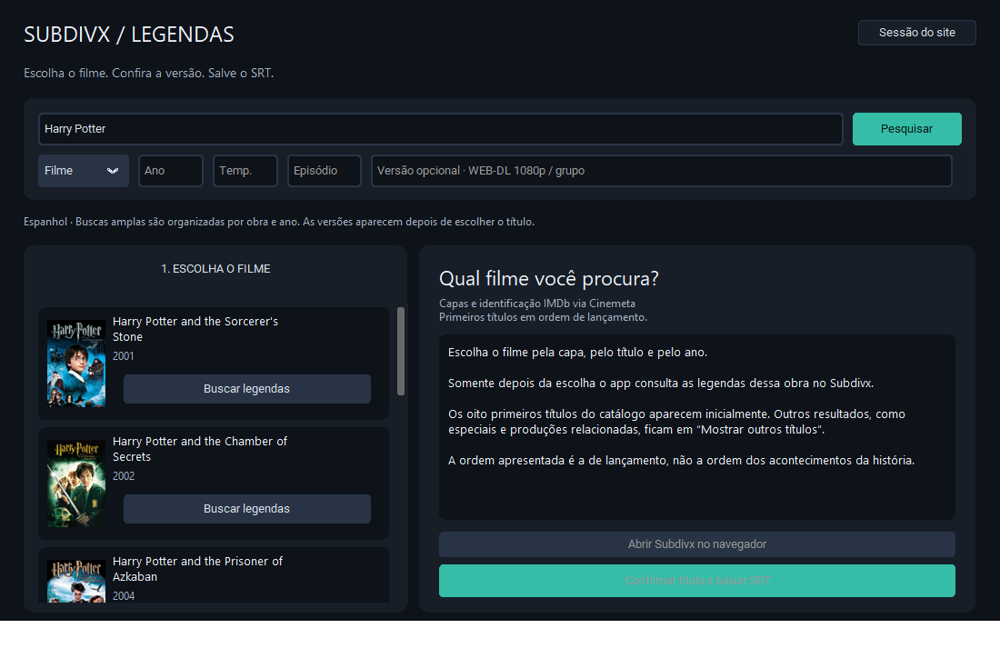

# Subdivx Desktop

Aplicación de escritorio en Python para identificar películas y series, comparar versiones de subtítulos de [Subdivx](https://subdivx.com/) y guardar archivos SRT en carpetas organizadas por título.

La búsqueda de películas empieza por un catálogo visual: eliges la obra por su **carátula, título y año** antes de consultar sus subtítulos. Así, una búsqueda como *Harry Potter* no mezcla las versiones de toda la saga en una sola lista.



*Captura de la aplicación real con resultados del catálogo. La interfaz actual está en portugués; esta documentación está redactada en español.*

## Funciones

- Búsqueda de películas y series, con año, temporada y episodio opcionales.
- Carátulas e identificadores de IMDb mediante Cinemeta, sin clave de API.
- Ocho títulos iniciales, ordenados por año de estreno, con opción de ampliar la lista.
- Consulta de subtítulos limitada a la obra elegida, con cinco versiones iniciales.
- Clasificación por título, año, episodio y versión del vídeo.
- Descarga de paquetes ZIP y RAR, extracción de SRT y conversión a UTF-8.
- Carpetas por obra y conservación de archivos existentes.

No traduce los subtítulos. El contenido de Subdivx está principalmente en español.

## Estado del acceso a Subdivx

**El acceso no está garantizado.** La aplicación utiliza un Firefox propio mediante [InvisiblePlaywright](https://github.com/feder-cr/invisible_playwright), pero Subdivx puede seguir solicitando verificaciones de Cloudflare o limitar las consultas.

Durante el desarrollo se completó una búsqueda y una descarga real de *Dune (2021)*. En una comprobación posterior, el sitio volvió a exigir una verificación. Las pruebas automatizadas comprueban el código y los flujos locales; no certifican la disponibilidad del servicio ni que una verificación se pueda superar en cada intento.

El catálogo y las carátulas funcionan de forma independiente. Que una película aparezca en el catálogo no implica que Subdivx tenga subtítulos compatibles.

## Requisitos e instalación

- Windows x64 y Python **3.11 o posterior**, disponible en `PATH`.
- Conexión a Internet.
- [7-Zip](https://www.7-zip.org/) o WinRAR para extraer paquetes RAR. Los ZIP no requieren una herramienta externa.

```powershell
git clone https://github.com/pietroxvier/subdivx-desktop.git
cd subdivx-desktop
.\Instalar.bat
.\Iniciar.bat
```

También puedes descargar el repositorio, extraerlo y ejecutar `Instalar.bat`. Para abrir la aplicación después, utiliza `Iniciar.bat`.

El instalador crea un entorno virtual y descarga las dependencias y el Firefox de InvisiblePlaywright. La descarga del navegador ocupa aproximadamente 240 MB y se guarda en la caché de la biblioteca, fuera del repositorio. La aplicación se ha probado en Windows; no se ha validado su funcionamiento completo en otros sistemas.

Instalación manual en PowerShell:

```powershell
python -m venv .venv
.\.venv\Scripts\python.exe -m pip install -r requirements.txt
.\.venv\Scripts\python.exe -m invisible_playwright fetch
.\.venv\Scripts\python.exe main.py
```

`requirements-lock.txt` contiene las versiones utilizadas durante la verificación. Para reproducir ese entorno, puedes instalar ese archivo en lugar de `requirements.txt`.

## Uso

1. Escribe un nombre, por ejemplo `Harry Potter`, `Dune 2021` o `The Bear S01E02`.
2. Ajusta **Filme / Série**, año, temporada o episodio si los conoces. El episodio escrito en el título se reconoce automáticamente.
3. Para películas sin año, elige primero su carátula y título. **Mostrar outros títulos** amplía el catálogo.
4. Pulsa **Buscar legendas** en la obra elegida. La consulta se limita a ese título y año.
5. Comprueba la descripción y la versión del vídeo. Puedes indicar `WEB-DL 1080p`, `BluRay` o el grupo de la edición.
6. Revisa las cinco primeras versiones. **Mostrar mais 5 versões** muestra más opciones; **Trocar filme** vuelve al catálogo.
7. Pulsa **Confirmar título e baixar SRT** para confirmar la publicación y descargar. **Abrir legendas** abre la carpeta de destino.

Las películas con año indicado y las series pueden consultarse directamente en Subdivx. Si aparecen obras distintas, sus publicaciones se agrupan por título, año y episodio antes de mostrar las versiones.

La primera conexión con Subdivx puede tardar alrededor de un minuto. El Firefox se reutiliza entre operaciones, las consultas de subtítulos repetidas se conservan en memoria durante cinco minutos y volver a opciones ya recibidas no requiere otra consulta al sitio.

### Archivos descargados

```text
legendas/
  Dune (2021)/
    Dune.WEB-DL [sdx-123456].srt
  The Bear/
    The.Bear.S01E02 [sdx-654321].srt
```

Los nombres se adaptan a Windows. Si un archivo ya existe, se añade un sufijo numérico. Cuando un paquete contiene varias versiones compatibles, se conservan todas. En series, se comprueban las marcas de temporada y episodio; solo se acepta un SRT sin identificación si es el único y la publicación confirma el episodio solicitado.

Los archivos ASS, SSA y SUB no se convierten a SRT. Si el paquete no contiene un SRT compatible, la aplicación solicita elegir otra publicación.

## Catálogo, carátulas e IMDb

La aplicación consulta **Cinemeta**, del ecosistema Stremio, y utiliza sus identificadores `tt...` de IMDb. Las carátulas se obtienen de Metahub. **No es una integración directa con la API comercial oficial de IMDb y no requiere una clave de API.**

Los ocho primeros resultados mantienen la prioridad del catálogo y se presentan por año de estreno. Las producciones relacionadas y los demás resultados aparecen al ampliar la lista. Esta selección depende del servicio, no de una lista de sagas incluida en el código.

Las carátulas se cargan en paralelo y su ausencia no impide continuar. Si el catálogo no responde, **Buscar diretamente no Subdivx** permite buscar sin esa primera etapa.

## Sesión y privacidad

En **Sessão do site**, el modo predeterminado es **Firefox (recomendado)**. La aplicación crea su propia sesión y no utiliza ni modifica el perfil personal del navegador. Firefox establece su propio User-Agent y las cookies son opcionales.

El modo alternativo **HTTP direto** puede necesitar los encabezados `Cookie` y `User-Agent` de una sesión válida:

1. Abre Subdivx y completa manualmente la verificación que solicite.
2. Abre las herramientas de desarrollo → Red / Network y realiza una búsqueda.
3. Selecciona la petición `ajax.php` → Headers → Request Headers.
4. Copia los valores de `Cookie` y `User-Agent` en los campos correspondientes de la aplicación.
5. Aplica la sesión y repite la búsqueda.

El campo de cookies admite un encabezado o un JSON exportado por Cookie-Editor. Acepta los prefijos `Cookie:` y `User-Agent:` y elimina saltos de línea accidentales. Del JSON solo se aprovechan las cookies de Subdivx.

Las cookies no se guardan en `config.json`. La sesión se mantiene en memoria y la biblioteca utiliza perfiles temporales. La configuración local guarda únicamente el modo de conexión y el User-Agent. También se puede proporcionar el encabezado con la variable de entorno `SUBDIVX_COOKIE_HEADER`.

El nombre buscado se envía a Cinemeta. Las cookies de Subdivx no se envían a Cinemeta ni a Metahub. La configuración, los registros, el entorno virtual y los subtítulos descargados quedan excluidos de Git mediante `.gitignore`.

## Clasificación y sincronización

La clasificación compara título normalizado, año y, en series, temporada y episodio. Descarta discrepancias explícitas de año o episodio y favorece las coincidencias de versión del vídeo. La popularidad tiene un peso secundario.

La puntuación indica **compatibilidad estimada**, no una probabilidad ni una valoración de la traducción. Se valida la estructura del SRT, pero no se analiza el vídeo ni se garantiza la sincronización. Comprueba siempre el título y la edición antes de descargar.

## Desarrollo y pruebas

```powershell
# Pruebas automatizadas, sin consultar Subdivx
.\.venv\Scripts\python.exe -m unittest discover -s tests -v

# Comprobaciones de la interfaz con datos de prueba
.\.venv\Scripts\python.exe tools\smoke_gui.py
.\.venv\Scripts\python.exe tools\verify_gui_flow.py
.\.venv\Scripts\python.exe tools\verify_catalog_gui.py

# Comprobaciones con servicios reales
.\.venv\Scripts\python.exe tools\probe_site.py
.\.venv\Scripts\python.exe tools\verify_scope_live.py
```

Las pruebas con servicios reales dependen de su disponibilidad. `verify_scope_live.py` descarga un SRT en una carpeta temporal y lo elimina al terminar. `verify_browser_live.py --download` guarda una descarga real en `legendas/`.

`tools/verify_rar.py` crea un paquete de prueba propio y necesita `Rar.exe` en la ruta habitual de WinRAR para generarlo. No hace falta para crear ZIP ni para ejecutar las pruebas unitarias.

| Archivo | Función |
| --- | --- |
| `subdivx_app/gui.py` | Interfaz CustomTkinter y gestión de eventos. |
| `subdivx_app/catalog.py` | Catálogo, identificadores IMDb y carátulas. |
| `subdivx_app/results.py` | Agrupación de publicaciones por obra. |
| `subdivx_app/core.py` | Protocolo, clasificación, caché y extracción. |
| `subdivx_app/browser.py` | Firefox persistente en un único hilo de trabajo. |

La red y la extracción se ejecutan fuera del hilo principal. Los widgets solo se actualizan desde el hilo de la interfaz. Al cancelar o cerrar, una conexión en curso puede tener que alcanzar su tiempo de espera antes de liberar los recursos.

## Referencias y agradecimientos

- [fr0gb1t/subx-bridge](https://github.com/fr0gb1t/subx-bridge): referencia del protocolo de búsqueda y descarga de Subdivx.
- [fr0gb1t/jellyfin-plugin-subx](https://github.com/fr0gb1t/jellyfin-plugin-subx): referencia de configuración de sesión y extracción. Su licencia declarada es GPL-3.0-or-later.
- [feder-cr/invisible_playwright](https://github.com/feder-cr/invisible_playwright): biblioteca del modo Firefox. El paquete declara MIT y Apache-2.0; el navegador modificado se distribuye bajo MPL-2.0.
- [Stremio Addon SDK](https://github.com/Stremio/stremio-addon-sdk): documentación del formato de catálogos y metadatos utilizado por Cinemeta.

El protocolo de esta aplicación se implementó por separado en Python. No necesita Jellyfin, Bazarr, Docker ni un servidor HTTP local. Los repositorios consultados y los binarios de las dependencias no se incluyen en esta publicación.
